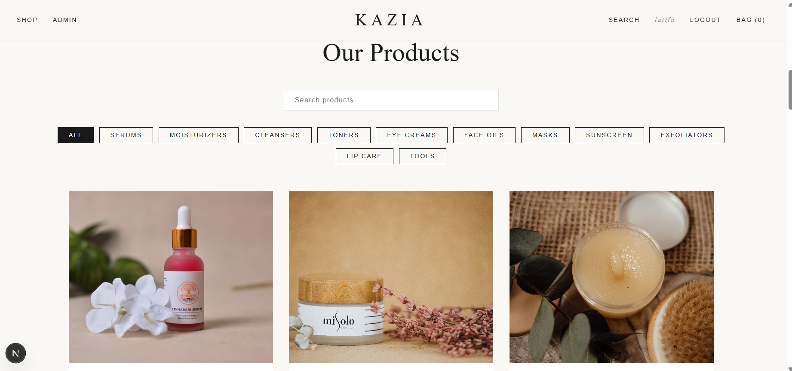
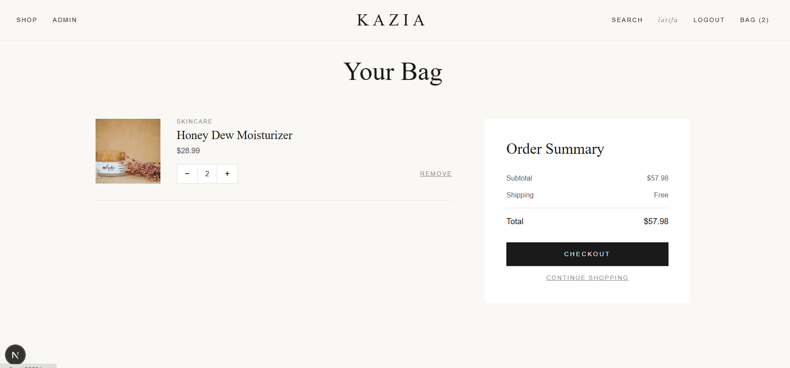
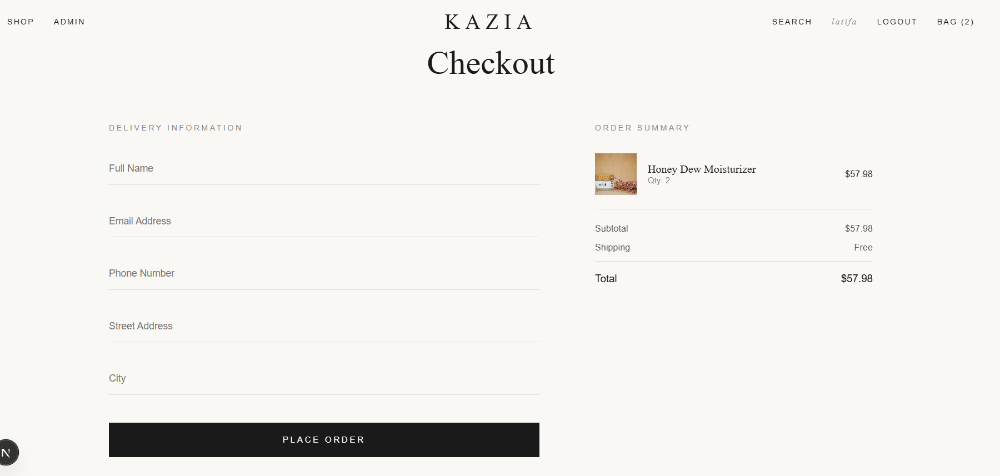
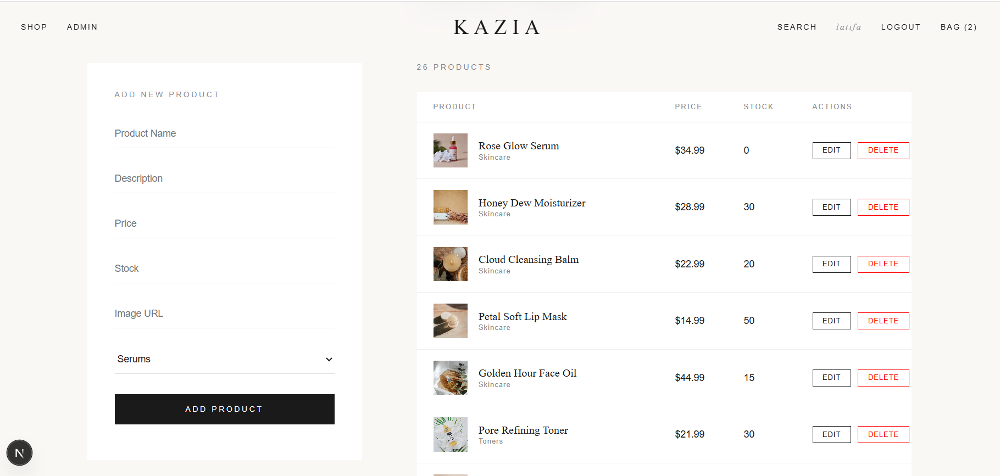
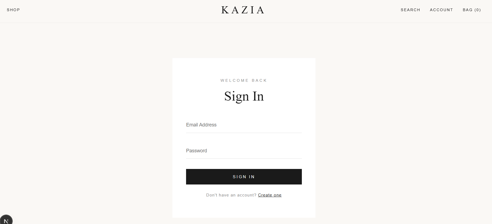

# Kazia Beauty (Frontend)

E-commerce website for skincare products, built with Next.js and React. This is the frontend; it talks to a Laravel REST API ([backend repo](https://github.com/boutmit33-commits/kazia-beauty-api)).

Built during my internship at Kazia Solutions.

## Features

- Browse products, search, and filter by category
- Shopping cart managed with React's Context API
- Checkout: the order is validated and saved by the server, and product stock is updated automatically
- Login and registration
- Admin panel (admin accounts only) to add, edit and delete products

## Screenshots

### Home


### Product page


### Cart


### Checkout


### Admin panel


### Login


## Tech stack

- Next.js / React
- JavaScript
- Laravel API (separate repo)

## Run it locally

You need the backend running first (see the backend repo).

```bash
npm install
npm run dev
```

Then open http://localhost:3000